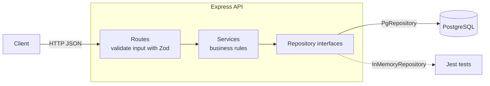

# Lab Equipment Tracker


REST API to register, reserve and track shared laboratory equipment (oscilloscopes, single-board computers, 3D printers…). It prevents double bookings, enforces availability rules and produces usage reports.

**Stack:** TypeScript · Node.js · Express · PostgreSQL · Docker · GitHub Actions · Jest · Python · Bash

**Highlights**

- Layered architecture (routes → services → repositories) with dependency injection
- Overlap detection for reservations, enforced both in a pure function and in SQL
- 50+ automated tests (unit and integration) with ~90% code coverage, running without a database
- CI on every push: lint, type check, tests with coverage, build, production dependency audit, Python tests and Docker image
- Python script for database backups and per-equipment usage reports

---

## Features

| Area | What it does |
|---|---|
| Equipment | Create, list (filter by category), get, update and delete equipment |
| Users | Create, list, get and update users; emails are unique |
| Reservations | Create, list (filter by equipment or user), get and cancel reservations |
| Rules | No overlapping reservations, no past reservations, only available equipment can be reserved |
| Reports | Backup of the database and CSV report of reservations and reserved hours per equipment |

## Architecture



- **Routes** parse and validate the request, then call a service. They know nothing about SQL.
- **Services** hold the business rules. They depend on repository **interfaces**, not on Postgres.
- **Repositories** are the only place with SQL.

Because services receive their repositories through the constructor, the tests inject in-memory repositories and run in seconds without a database.

## Business rules

| Rule | Response |
|---|---|
| Request body or parameters are invalid | `400 Bad Request` |
| Equipment, user or reservation does not exist | `404 Not Found` |
| Email already registered | `409 Conflict` |
| Equipment already reserved in that time range | `409 Conflict` |
| Reservation already cancelled | `409 Conflict` |
| Equipment is in maintenance or retired | `422 Unprocessable Entity` |
| Reservation starts in the past, or already started when cancelling | `422 Unprocessable Entity` |

### How overlaps are detected

Two time ranges overlap when **each one starts before the other ends**:

```ts
a.startsAt < b.endsAt && b.startsAt < a.endsAt
```

Strict `<` means back-to-back bookings are allowed (one ending at 12:00 and the next starting at 12:00). The same condition runs in SQL with `SELECT EXISTS`, backed by an index on `(equipment_id, starts_at, ends_at)`. Cancelled reservations never block a time slot.

## Getting started

Requirements: Docker.

```bash
docker compose up -d --build
```

The API runs at `http://localhost:3000` with sample data. On Linux or macOS you can also run `./scripts/setup.sh`.

### Local development

```bash
cp .env.example .env
docker compose up -d db
npm install
npm run dev
```

## API

### Equipment

| Method | Endpoint | Description |
|---|---|---|
| GET | `/api/equipment?category=` | List equipment, optionally by category |
| GET | `/api/equipment/:id` | Get one item |
| POST | `/api/equipment` | Create equipment |
| PATCH | `/api/equipment/:id` | Update name, category, location or status |
| DELETE | `/api/equipment/:id` | Delete equipment |

### Users

| Method | Endpoint | Description |
|---|---|---|
| GET | `/api/users` | List users |
| GET | `/api/users/:id` | Get one user |
| POST | `/api/users` | Create a user (role defaults to `student`) |
| PATCH | `/api/users/:id` | Update name, email or role |

### Reservations

| Method | Endpoint | Description |
|---|---|---|
| GET | `/api/reservations?equipmentId=&userId=` | List reservations, optionally filtered |
| GET | `/api/reservations/:id` | Get one reservation |
| POST | `/api/reservations` | Create a reservation |
| POST | `/api/reservations/:id/cancel` | Cancel an upcoming reservation |

Example:

```bash
curl -X POST http://localhost:3000/api/reservations \
  -H "Content-Type: application/json" \
  -d '{"equipmentId": 2, "userId": 1, "startsAt": "2027-01-15T10:00:00-06:00", "endsAt": "2027-01-15T12:00:00-06:00"}'
```

Dates are stored in UTC (`TIMESTAMPTZ`); any ISO 8601 offset is accepted.

## Testing

```bash
npm test                 # all tests
npm run test:coverage    # tests + coverage report
python -m unittest discover -s scripts   # Python script tests
```

| Suite | Type | Covers |
|---|---|---|
| `reservation.rules.test.ts` | Unit | Overlap rule, including edge cases |
| `reservation.service.test.ts` | Unit | Schema validation and every service rule |
| `equipment`, `users`, `reservations`, `reservation.cancel` | Integration | Full HTTP requests through Express with in-memory repositories |

## Reports and backups

With the containers running:

```bash
python scripts/backup_and_report.py
```

- Saves a `pg_dump` backup in `backups/`.
- Saves `reports/usage_YYYYMMDD.csv` with reservations and reserved hours per equipment (active reservations only) and prints a summary, including equipment that was never reserved.
- Options: `--backup-only`, `--report-only`, `--local` (use a local `psql` and `DATABASE_URL` instead of Docker).

Only the Python standard library is used.

## Project management

Work was planned as GitHub issues on a Kanban board (GitHub Projects). Each issue was developed on its own branch and merged through a pull request after CI passed.

## Technical decisions

- **PostgreSQL**: `CHECK` constraints, foreign keys, `RETURNING`, `TIMESTAMPTZ` and `EXISTS` fit a reservations domain well.
- **Layered architecture with dependency injection**: business rules are testable without a database or HTTP server.
- **Zod**: runtime validation, since TypeScript types disappear after compilation.
- **Cancel instead of delete**: cancelled reservations keep the history for reports and free the time slot.
- **`POST /:id/cancel` instead of `PATCH status`**: cancelling has its own rules, so it is an explicit action rather than a free field edit.
- **Docker Compose**: the whole stack starts with one command, identical on every machine.

## Security notes

- All SQL uses parameterized queries (`$1`, `$2`…), which prevents SQL injection.
- Configuration and credentials come from environment variables; `.env` is never committed.
- `npm audit --omit=dev` reports **0 vulnerabilities** in production dependencies, and CI fails if a high-severity one appears.
- The remaining `npm audit` warnings come from `sprintf-js`, a transitive dependency of the test coverage tooling. No patched version exists yet; it only runs during development and never receives user input.

## Author

Alexander Rodríguez Del Valle · [GitHub](https://github.com/mclovinR)
